# PORTFOLIO - Robby Arzy

A modern, responsive personal portfolio website built with **Next.js, TypeScript, and Tailwind CSS**, showcasing my software engineering projects, technical skills, and development experience.

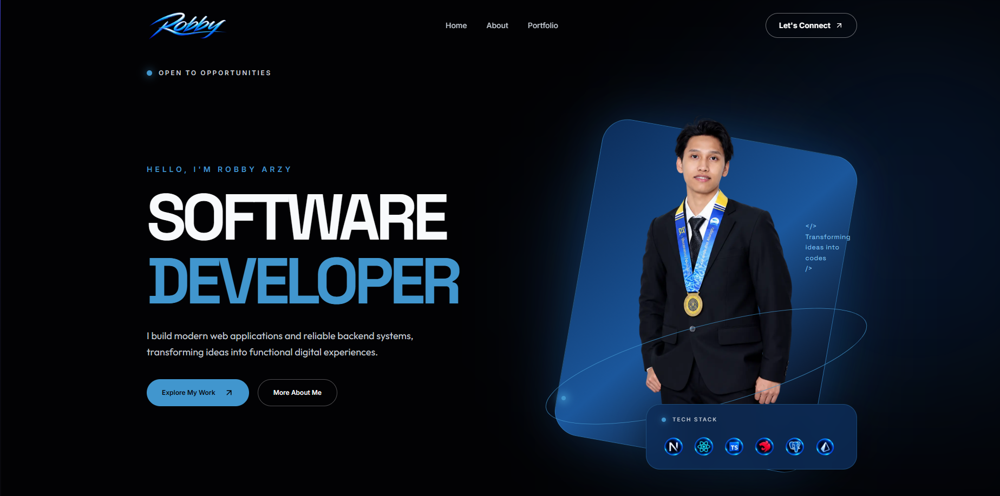
**Live Website:** [https://portfolio-beta-one-7z2v2zvcze.vercel.app]

**GitHub Repository:** https://github.com/Arzy4/Portfolio

---

## 1. OVERVIEW

**This portfolio was developed to introduce my background as an Electrical Engineer transitioning into Software Engineer**, reflecting my journey of learning, exploring, and applying modern web development technologies. It serves as a central platform to **showcase my technical skills, featured projects, and hands-on experience in both frontend and backend development**.

**Built using Next.js, TypeScript, and Tailwind CSS**, the website features a modern and responsive interface designed to provide a seamless experience across desktop, tablet, and mobile devices. It includes interactive project showcases, detailed project documentation, and an integrated contact form to make it easier for visitors to explore my work and connect with me.

Beyond showcasing my projects, this portfolio also **improves my understanding** of component-based development, responsive design, API integration, and deployment practices. Through this project, I aim to highlight my **continuous growth as an aspiring Software Engineer**, my problem-solving approach, and my commitment to building functional, maintainable, and user-friendly web applications.

## 2. FEATURES

- **Responsive Design:** Optimized layouts for desktop, tablet, and mobile devices.
- **Interactive Project Carousel:** Browse featured projects with navigation controls and animated transitions.
- **Project Detail Pages:** Explore project overviews, development contributions, technologies, and future improvements.
- **Tech Stack Showcase:** Display technologies used throughout my software engineering journey.
- **Contact Form:** Allow visitors to send messages through an integrated email service.
- **Security Headers:** Implement selected HTTP security headers using Next.js Proxy.
- **Smooth Navigation:** Navigate between portfolio sections using anchor links.

## 3. TECH STACK

| Category | Technologies |
|---|---|
| Framework | Next.js 16 |
| Language | TypeScript |
| UI Library | React |
| Styling | Tailwind CSS v4 |
| Icons | Lucide-React, React Icons |
| Fonts | Inter, Space Grotesk, Outfit |
| Deployment | Vercel |
| Version Control | Git & GitHub |
| Email Integration | Resend |

## 4. PROJECT STRUCTURE

```text
Portfolio/
├── .next/
├── node_modules/
├── public/
│   ├── projectImage/
├── src/
│   ├── app/
│   │   ├── api/
│   │   ├── components/
│   │   ├── projectDetailPage/
│   │   ├── globals.css
│   │   ├── icon.png
│   │   ├── layout.tsx
│   │   └── page.tsx
│   ├── data/
│   └── proxy.ts
├── .env.local
├── .gitignore
├── next.config.ts
├── package.json
└── README.md
```

## 5. FEATURED PROJECTS

### VOLTRA — EV Charging Reservation Platform

A full-stack web application designed to help EV drivers discover charging stations, explore available charging slots, and manage reservations.

**Technologies:** Next.js, TypeScript, Tailwind CSS, NestJS, PostgreSQL, Prisma ORM.

### FINTRACK — Financial Management REST API

A backend application supporting financial account management, transaction tracking, authentication, and database integration.

**Technologies:** NestJS, TypeScript, PostgreSQL, Prisma ORM, JWT.

### REVOSHOP — E-Commerce Web Application

A responsive e-commerce application featuring product browsing, shopping cart management, authentication, and product administration.

**Technologies:** Next.js, React, TypeScript, Tailwind CSS, Platzi Fake Store API.

## 6. GETTING STARTED

### Prerequisites

- Node.js (a version compatible with Next.js 16)
- npm
- Git

### Installation

Clone the repository:

```bash
git clone https://github.com/Arzy4/Portfolio.git
```

Navigate to the project directory:

```bash
cd Portfolio
```

Install dependencies:

```bash
npm install
```

Start the development server:

```bash
npm run dev
```

Open http://localhost:3000 in your browser.

## 7. ENVIRONMENT VARIABLES

The contact form requires environment variables to authenticate with the configured email service.

Create a `.env.local` file in the project root and add the variables required by your email integration.

```env
# Replace with the actual variable names used by your email service
RESEND_API_KEYS=your-resend-api-key
CONTACT_EMAIL=your-email-address
```

**Security Note:** Never commit `.env.local` or expose private API keys and email credentials in the repository.

## 8. SECURITY & PROXY

This portfolio uses the Next.js 16 Proxy convention to configure selected HTTP security headers.

| Header | Value |
|---|---|
| X-Content-Type-Options | nosniff |
| Referrer-Policy | strict-origin-when-cross-origin |
| X-Frame-Options | DENY |

Proxy applies these headers to the homepage and project detail pages.

## 9. DEPLOYMENT

The portfolio is deployed using **Vercel**. To deploy:

**a. Push the Project to GitHub**

Ensure all project files are committed and pushed to the GitHub repository.

```bash
git add .
git commit -m "Prepare portfolio for deployment"
git push origin main
```

**b. Import the Repository into Vercel**

1. Open the Vercel Dashboard.
2. Click Add New → Project.
3. Connect your GitHub account if it is not already connected.
4. Select the Portfolio repository.
5. Click Import.

**c. Configure Build Settings**

Vercel automatically detects the Next.js framework. Verify the following deployment settings:

| Configuration | Value |
|---|---|
| Framework Preset | Next.js |
| Root Directory | ./ |
| Install Command | npm install |
| Build Command | npm run build |
| Output Directory | Next.js Default |

The installation command installs the required dependencies, while the build command generates the production-ready application.

**d. Configure Environment Variables**

Navigate to Project Settings → Environment Variables in Vercel and add the following variables:

```bash
RESEND_API_KEYS=your-resend-api-key
CONTACT_EMAIL=your-email-address
```

These variables are required for the Resend email integration used by the portfolio contact form. Ensure the variables are configured for the Production environment.

**e. Deploy the Application**

1. Review the project configuration.
2. Click Deploy.
3. Wait for Vercel to install dependencies and complete the production build.
4. Once deployment succeeds, Vercel will generate a public URL for the portfolio.
5. Future commits pushed to the connected production branch will automatically trigger new deployments.

**f. Verify the Deployment**

After deployment, open the generated Vercel URL and verify that:

- The homepage loads successfully.
- Images, fonts, and icons display correctly.
- Navigation links and project detail pages work properly.
- The project carousel functions as expected.
- The website remains responsive across desktop, tablet, and mobile devices.

**g. Verify the Contact Form**

Test the Resend email integration in the production environment:

1. Navigate to the Contact section.
2. Fill in the required fields with valid information.
3. Click Send Message.
4. Verify that the application displays a successful submission response.
5. Check the configured recipient email inbox to confirm the message was delivered.
6. If the message fails, inspect the Vercel runtime logs and verify the Resend environment variables.

## 10. WEBSITE SCREENSHOT

### HOME PAGE
#### Hero Section


#### Process Section
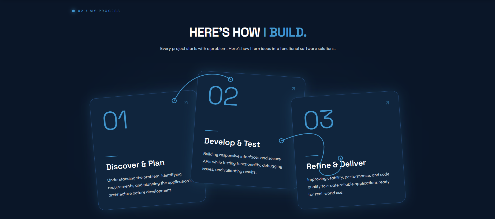

#### Project Section
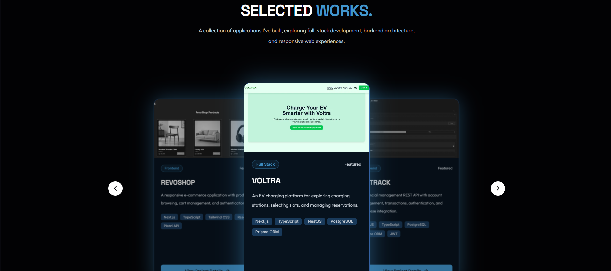

#### About Section
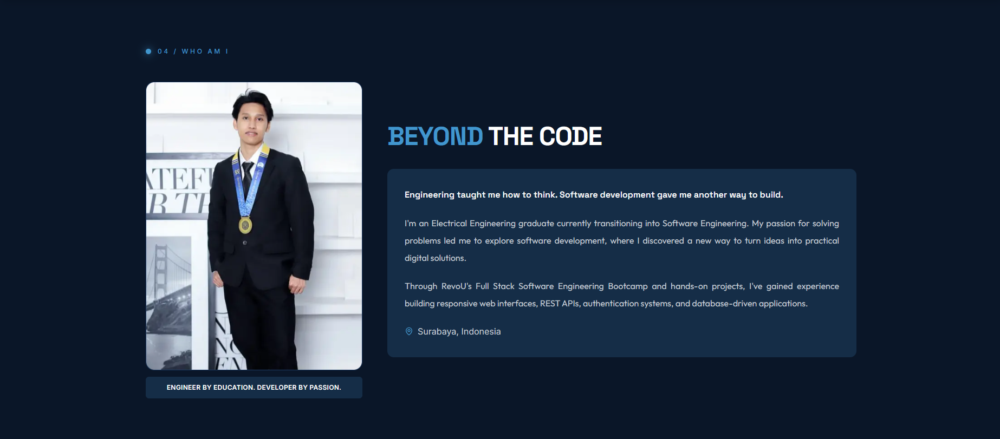

#### Contact Section
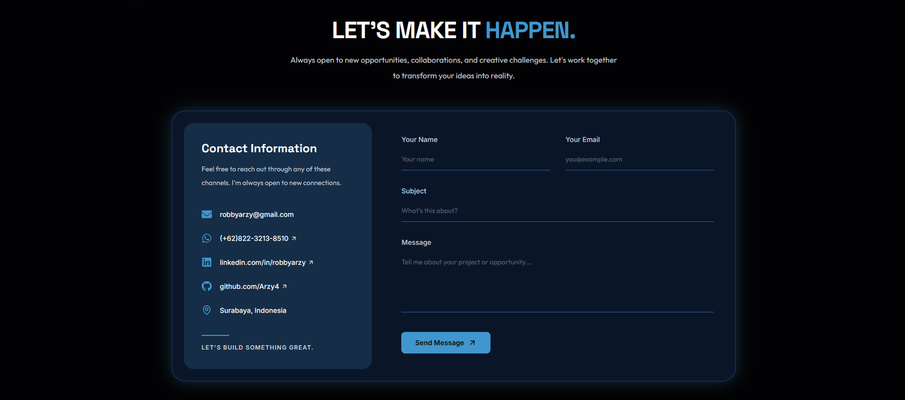

---

### PROJECT DETAIL PAGE
#### Voltra
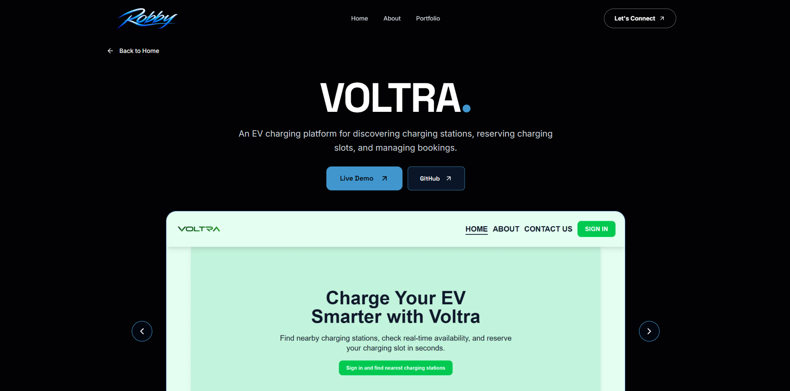
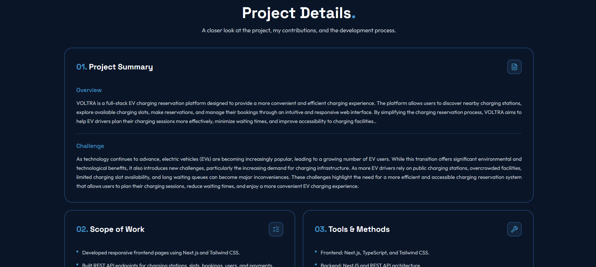
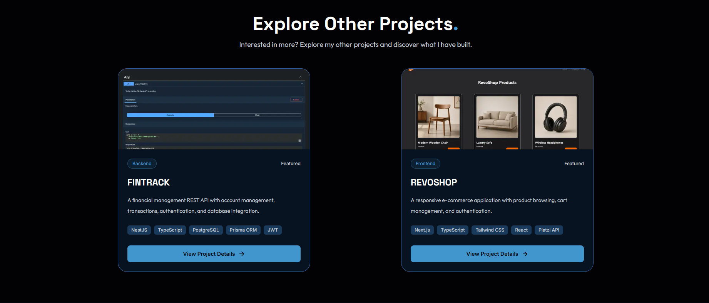

#### Fintrack
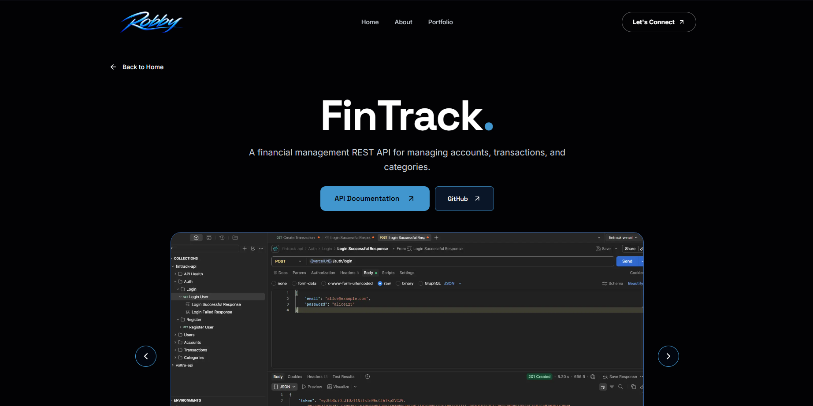
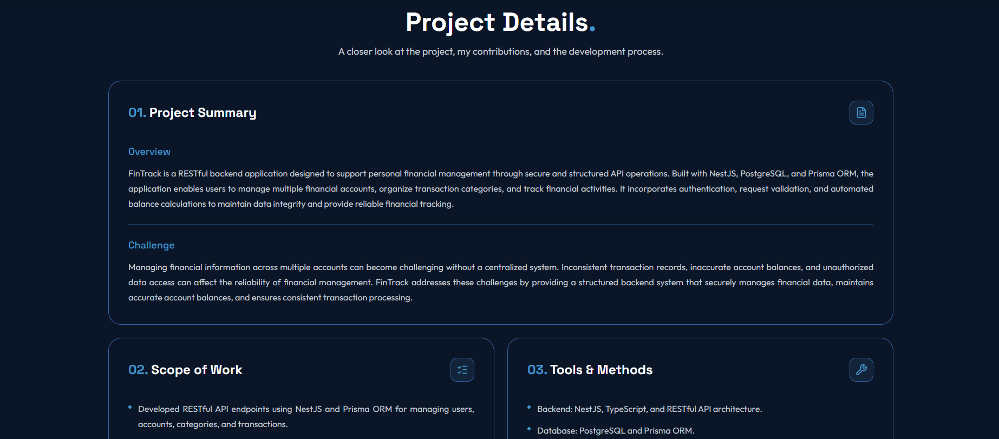
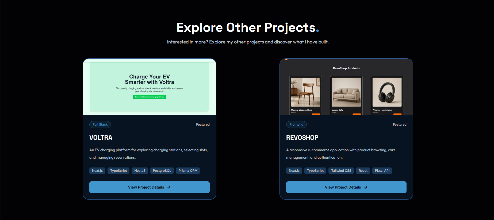

#### Revoshop
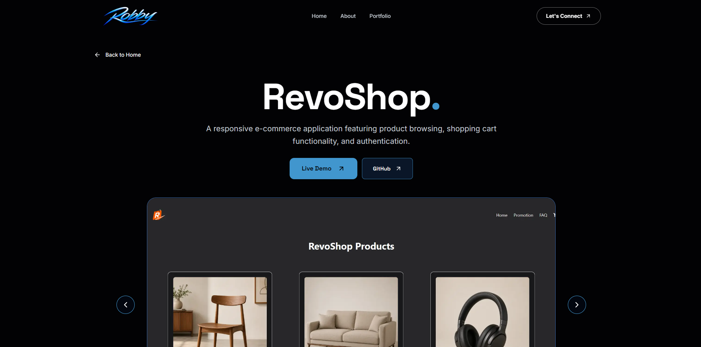
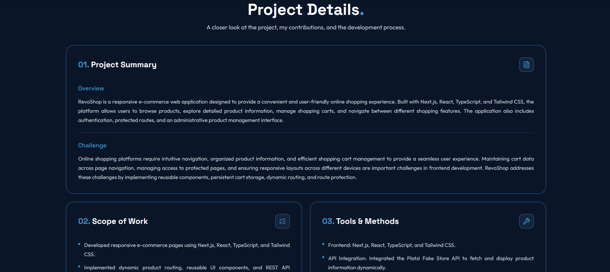
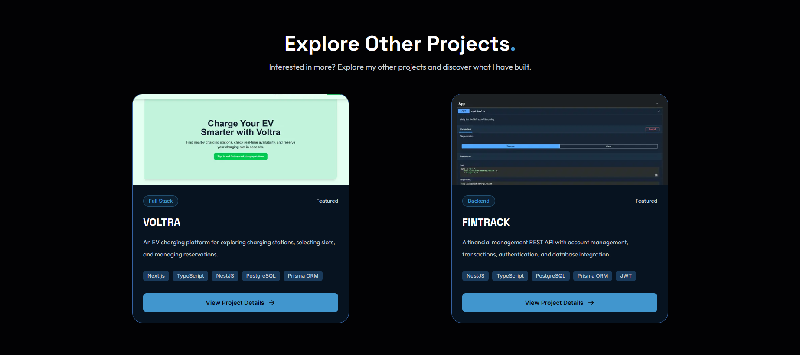
